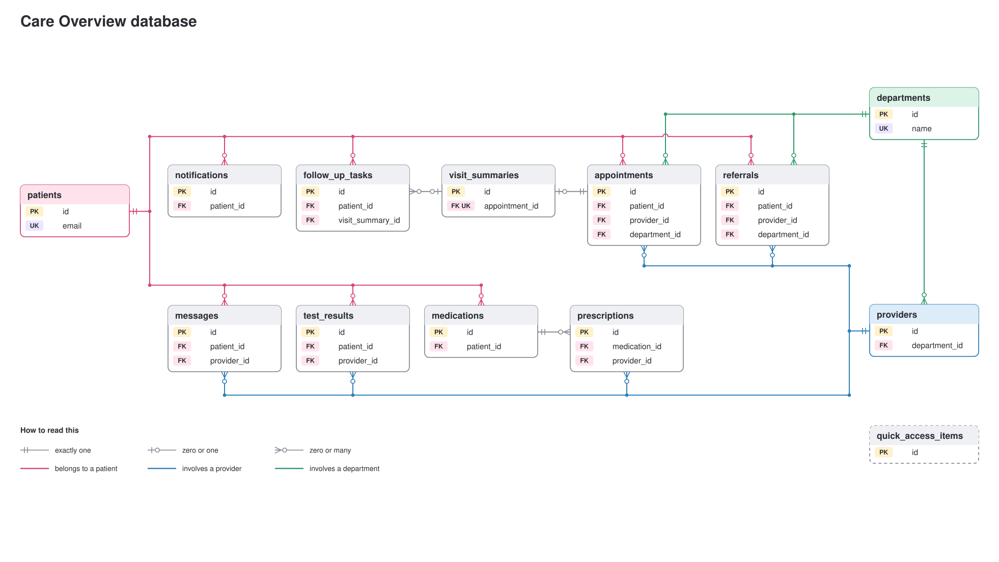

# Care Overview ER Diagram

Entity-relationship diagram for the SQLite database in [`schema.sql`](../schema.sql).



The diagram above shows the keys of every table and is sized 16:9, so it drops straight onto a slide. [`er_diagram_full.svg`](er_diagram_full.svg) shows every column of every table.

## How to read it

- **Pink line:** the table belongs to a patient. **Blue line:** it involves a provider. **Green line:** it involves a department.
- **Line ends:** two bars mean exactly one. A bar and a circle mean zero or one. A circle and a fork mean zero or many.
- **PK, FK, UK:** primary key, foreign key, unique.

## Notes

- **13 tables, 18 foreign keys.** `patients`, `providers` and `departments` are the three tables that most others point to.
- **One-to-one:** each appointment has at most one visit summary, because `visit_summaries.appointment_id` is `UNIQUE`.
- **Optional link:** `follow_up_tasks.visit_summary_id` can be empty, because a task does not have to come from a visit.
- **`notifications` has no foreign key to its source.** `source_type` and `source_id` name a row in `messages`, `test_results`, `follow_up_tasks`, `referrals`, `prescriptions` or `appointments`. SQLite cannot enforce that kind of reference, so the app keeps it correct.
- **`quick_access_items` stands alone.** It holds the shortcut links and relates to no other table.
- **`care_overview_view` is a view, not a table.** It reads `patients`, `appointments`, `visit_summaries`, `follow_up_tasks`, `messages`, `test_results`, `referrals`, `prescriptions`, `medications` and `notifications` to produce one summary row per patient.
- **Dates are stored as text** (`YYYY-MM-DD HH:MM:SS`) because SQLite has no date type.

## Updating the diagram

The two images are drawn from `schema.sql`. After the schema changes, run this from the project folder to redraw them:

```text
python docs/make_er_diagram.py
```

A new table needs one line added to the `CENTRAL` list in that script so it gets a place in the layout.
