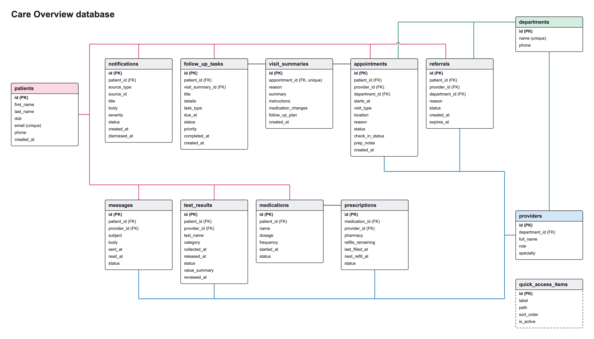

# Care Overview ER Diagram



## Notes

- 13 tables and 18 foreign keys. The columns shown are the same as in [`schema.sql`](../schema.sql).
- Pink lines go to patients, blue lines to providers, green lines to departments. Grey lines link tables that follow each other, like appointments and visit summaries.
- Each appointment has at most one visit summary.
- A task does not have to come from a visit.
- `notifications` points at a message, result, task, referral, prescription or appointment through `source_type` and `source_id`. SQLite can't enforce that, so the app does.
- `quick_access_items` stands alone.
- `care_overview_view` is a view, not a table. It builds one summary row per patient.

## Redrawing

After the schema changes, run this from the project folder to redraw the SVG and PNG:

```text
python docs/make_er_diagram.py --png
```

A new table needs one name added to `TOP_ROW` or `BOTTOM_ROW` in that script.
